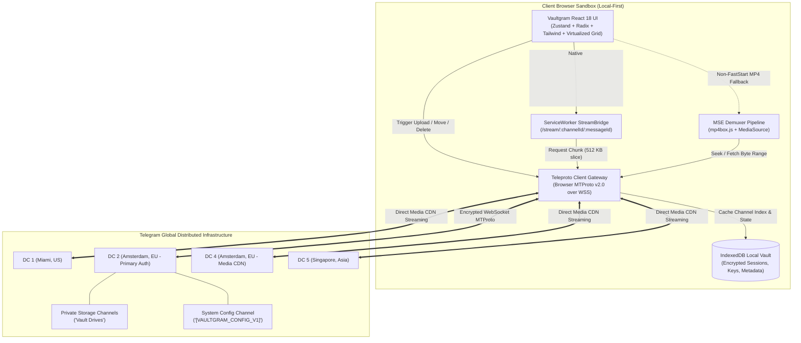

<p align="center">
  
</p>

<h1 align="center">Vaultgram</h1>

<p align="center">
  <strong>Browser-native, 100% serverless personal cloud drive and on-demand streaming engine powered directly by Telegram's MTProto API over WebSockets.</strong>
</p>

<p align="center">
  <a href="https://vaultgram.pages.dev"></a>
  <a href="LICENSE"></a>
  
  
  
</p>

---

## Table of Contents

- [Overview](#overview)
- [Why Vaultgram?](#why-vaultgram)
- [Architectural Topology](#architectural-topology)
- [Deep-Dive Engineering](#deep-dive-engineering)
  - [1. Dual-Path Streaming Engine](#1-dual-path-streaming-engine-serviceworker--mse)
  - [2. Multi-Worker Parallel Transfer Engine](#2-multi-worker-parallel-transfer-engine)
  - [3. Zero-Backend Cloud Synchronization (SyncStore)](#3-zero-backend-cloud-synchronization-syncstore)
  - [4. 10k+ File Virtualization & Media Indexing](#4-10k-file-virtualization--media-indexing)
- [Feature Breakdown](#feature-breakdown)
- [Technical Stack](#technical-stack)
- [Keyboard Control Center](#keyboard-control-center)
- [Getting Started](#getting-started)
  - [Obtaining Telegram API Credentials](#obtaining-telegram-api-credentials)
  - [Local Installation](#local-installation)
- [Self-Hosting & Deployment](#self-hosting--deployment)
  - [Cloudflare Pages](#cloudflare-pages-recommended)
  - [Docker & Nginx](#docker--nginx-self-hosting)
- [Security & Threat Model](#security--threat-model)
- [Frequently Asked Questions](#frequently-asked-questions)
- [License](#license)

---

## Overview

Most cloud storage solutions force a painful compromise between monthly storage subscriptions, privacy exposure, and proprietary lock-in. While Telegram provides virtually infinite cloud storage for personal media, leveraging it as a real filesystem has traditionally required:
- Third-party bots with harsh file size caps (20MB / 50MB) and severe `FLOOD_WAIT` bans.
- Intermediary relay servers that hold your personal auth keys and proxy every gigabyte of traffic.
- Clunky desktop clients that require downloading entire multi-gigabyte files to disk before playback or inspection.

**Vaultgram** eliminates all intermediaries. It is a **100% browser-native client** that connects directly to Telegram's distributed MTProto Data Centers (DC 1 through 5) over encrypted WebSockets. It delivers an architectural-grade personal cloud drive, universal file browser, and instant on-the-fly streaming pipeline with zero server footprint.

---

## Why Vaultgram?

| Paradigm | Traditional Cloud (Drive / Dropbox) | Telegram Bot Web UIs | Vaultgram |
| :--- | :--- | :--- | :--- |
| **Hosting Cost** | $10–$50/mo per TB | Requires hosting a Python/Node bot server | **$0 (100% Static Client-Side)** |
| **Middleman Servers** | Third-party corporate datacenters | Intermediary server holding bot tokens | **Zero (Browser ➔ Telegram DCs direct)** |
| **Video Playback** | Transcoded on server | Requires full file download | **Instant seekable range streaming** |
| **File Size Limit** | Hard plan caps | 20MB (Standard Bot API) / 50MB (Local Server) | **2GB (Free Accounts) / 4GB (Premium)** |
| **Privacy / Encryption**| Corporate key custody | Server administrator access | **Pure MTProto 2.0 (Keys stay in browser)** |
| **Filesystem UX** | Folders, virtual tags, bulk move | Flat chronological chat stream | **Hierarchical drives, folders, bulk operations** |

---

## Architectural Topology



---

## Deep-Dive Engineering

### 1. Dual-Path Streaming Engine (ServiceWorker + MSE)

Standard web browsers cannot natively stream video from Telegram because Telegram stores files as discontinuous MTProto document parts rather than HTTP range-accessible URLs. Vaultgram implements a **dual-engine media transport**:

- **Path A: ServiceWorker Virtual Range Bridge (`StreamBridge`)**
  The ServiceWorker intercepts requests matching `/stream/:channelId/:messageId`. When the browser's HTML5 video player sends standard HTTP range headers (e.g. `Range: bytes=1048576-1572863`), the ServiceWorker computes the exact 512KB chunk boundary, pulls the MTProto part directly via `upload.getFile`, and streams a synthetic `206 Partial Content` response back into the player.
  
- **Path B: In-Browser Demuxer & MediaSource Controller (`Mp4DemuxSegmenter` + `MseStreamController`)**
  For MP4 videos with `moov` atoms positioned at the tail of the file (non-FastStart) or non-standard container layouts, the MSE pipeline takes over:
  1. **Header Discovery**: Probes the first 2MB; if the `moov` atom is absent, it probes the last 2MB of the remote file.
  2. **Demuxing**: Parses ISO-BMFF box structures in JavaScript using `mp4box.js`.
  3. **Fragmentation**: Emits MSE initialization segments and fragments continuous audio/video sample streams into valid `moof` + `mdat` chunks.
  4. **Keyframe-Accurate Seeking**: Leverages `mp4box.seek(time, true)` to fetch only the required keyframe segments from Telegram, preventing full-file downloads.

- **Cross-DC Media Routing & Auto-Healing**:
  Files uploaded to Telegram are geographically distributed. If a user is registered on **DC 2 (Amsterdam)** but streaming media stored on **DC 1 (Miami)**:
  - Vaultgram automatically initiates an `auth.exportAuthorization` on DC 2 and executes `auth.importAuthorization` on DC 1.
  - If a file reference token expires during long playback sessions (`FILE_REFERENCE_EXPIRED`), the transport automatically fetches the parent message and refreshes the MTProto file reference without interrupting playback.

---

### 2. Multi-Worker Parallel Transfer Engine

Both uploads and downloads are executed through high-throughput worker pools:

- **Parallel Chunked Uploads**:
  Files are chunked into 512KB slices and dispatched across 4 concurrent WebSocket workers. Instantaneous upload throughput and dynamic ETAs are calculated using a 500ms sliding telemetry window. Uploads support pause, resume, and cancellation through native `AbortController` primitives.
- **Parallel Chunked Downloads**:
  The download subsystem consumes atomic job indices (`nextJobIndex++`) across 4 parallel workers. Chunks are collected in pre-allocated typed arrays, verified for byte integrity, and synthesized into browser `Blob` objects before triggering native file downloads.

---

### 3. Zero-Backend Cloud Synchronization (`SyncStore`)

To provide true cross-device synchronization without hosting an external database, Vaultgram utilizes a designated private Telegram channel:
1. **Bootstrap Resolution**: On initial launch, Vaultgram scans the user's dialogs for a private channel titled `"Vaultgram Vault (Do Not Delete)"` containing the signature tag `[VAULTGRAM_CONFIG_V1]`.
2. **Deterministic Locking**: A mutex lock (`initPromise`) prevents race conditions during concurrent mounts or React 18 StrictMode render cycles.
3. **Write Coalescing**: Changes to virtual folder hierarchies, pinned items, favorite bookmarks, and UI view preferences are coalesced with a 3-second optimistic debounce before editing the pinned configuration message.

---

### 4. 10k+ File Virtualization & Media Indexing

Indexing channels with tens of thousands of messages without freezing the browser requires strict memory disciplines:
- **Cold-Start Hydration**: Channel indices are cached locally in `IndexedDB`, achieving instantaneous UI loads upon subsequent visits.
- **Incremental Forward Sync**: Uses `client.getMessages(channel, { minId: highestKnownId })` to sync only newly arriving media messages.
- **Non-Blocking Historical Pagination**: Scans message history in 100-item chunks with cooperative microtask yields (`60ms`), preserving 60 FPS UI responsiveness.
- **DOM Windowing**: Both the visual Grid and dense Table views leverage `@tanstack/react-virtual` with dynamic row/cell recycling, ensuring buttery smooth scrolling across catalogs of 10,000+ files.

---

## Feature Breakdown

- 🛡️ **Zero-Intermediary Architecture**: Direct browser-to-datacenter WebSocket connections.
- 🎬 **Instant Range Video Streaming**: Seekable 4K/1080p playback powered by ServiceWorker range emulation.
- 🎵 **Floating Background Audio Engine**: Persistent audio playback across drives with queue management and scrubbing.
- 📑 **In-Browser PDF Reader**: Integrated `pdfjs-dist` worker viewer with zooming and text search.
- 📦 **In-Memory ZIP Explorer**: Inspect `.zip` file listings and extract individual files without unzipping the archive locally.
- 🖼️ **High-DPI Image Viewer**: Fullscreen photo canvas with prefetching and pan-zoom.
- ⚡ **Command Center (`Cmd+K`)**: Global spotlight palette for instantaneous navigation, filtering, and drive controls.
- 📂 **Virtual Directory Hierarchy**: Organize flat channel file feeds into custom nested folder hierarchies.
- 👥 **Multi-Account Switcher**: Seamlessly switch between multiple authenticated Telegram profiles on one device.
- 📊 **Real-Time Network Telemetry**: View live ping latency to Telegram DCs, socket states, and active worker pipelines.
- 💾 **Session String Portability**: Export your authenticated MTProto session string for CLI automation, scripts, or backups.

---

## Technical Stack

| Layer | Technologies |
| :--- | :--- |
| **Core Framework** | React 18, TypeScript 5, Vite 6 |
| **MTProto Transport** | `teleproto` (Modern active MTProto protocol engine over WSS) |
| **Media & Demuxing** | `@vidstack/react`, `mp4box.js`, `pdfjs-dist`, `jszip` |
| **Interface & Styling** | Tailwind CSS, Radix UI Primitives, Lucide Icons, Framer Motion |
| **Virtualization & State** | `@tanstack/react-virtual`, `zustand`, `idb-keyval` (IndexedDB) |
| **ServiceWorker** | Browser ServiceWorker API, Web Crypto API |

---

## Keyboard Control Center

Vaultgram is built for keyboard-driven efficiency:

| Shortcut | Action | Scope |
| :--- | :--- | :--- |
| <kbd>Cmd</kbd> / <kbd>Ctrl</kbd> + <kbd>K</kbd> | Open Command Palette | Global |
| <kbd>/</kbd> | Focus File Search Bar | Workspace |
| <kbd>Shift</kbd> + <kbd>U</kbd> | Open File Upload Dialog | Workspace |
| <kbd>Space</kbd> | Quick Look / Preview Selected Item | File Grid / Table |
| <kbd>Esc</kbd> | Dismiss Modal / Deselect All Items | Global |
| <kbd>Delete</kbd> / <kbd>Backspace</kbd> | Batch Delete Selected Items | Multi-Selection |
| <kbd>Shift</kbd> + <kbd>Click</kbd> | Range Selection of Files | File Grid / Table |
| <kbd>?</kbd> | Open Keyboard Shortcuts Cheat Sheet | Global |

---

## Getting Started

### Obtaining Telegram API Credentials

Because Vaultgram connects directly to Telegram as a native MTProto client, you need personal Telegram API credentials (free, takes 60 seconds):

1. Visit [my.telegram.org](https://my.telegram.org) and log in with your phone number.
2. Select **API development tools**.
3. Create a new application (e.g. Title: `Vaultgram`, Short name: `vaultgram`).
4. Copy your **`api_id`** (numeric) and **`api_hash`** (alphanumeric string).

### Local Installation

1. **Clone the repository**:
   ```bash
   git clone https://github.com/xrnix/Vaultgram.git
   cd Vaultgram
   ```

2. **Install dependencies**:
   ```bash
   npm install
   ```

3. **Start the development server**:
   ```bash
   npm run dev
   ```

4. **Connect your Vault**:
   - Open your browser to `http://localhost:5173`.
   - Enter your `API ID` and `API Hash`.
   - Authenticate via QR Code, Phone SMS, or an existing GramJS/Teleproto Session String.

---

## Self-Hosting & Deployment

Vaultgram produces a 100% static client build that requires zero server-side runtimes.

### Cloudflare Pages (Recommended)

1. Connect your GitHub repository to Cloudflare Pages.
2. Configure build settings:
   - **Framework Preset**: `Vite`
   - **Build Command**: `npm run build`
   - **Build Output Directory**: `dist`
   - **Environment Variables**: `NODE_VERSION = 18`
3. Deploy! The included `public/_headers` and `public/_redirects` automatically configure ServiceWorker scopes and SPA fallback routing.

### Docker & Nginx (Self-Hosting)

Create a `Dockerfile` in the root:

```dockerfile
# Build Stage
FROM node:18-alpine AS builder
WORKDIR /app
COPY package*.json ./
RUN npm ci
COPY . .
RUN npm run build

# Production Static Server Stage
FROM nginx:alpine
COPY --from=builder /app/dist /usr/share/nginx/html
COPY <<EOF /etc/nginx/conf.d/default.conf
server {
    listen 80;
    server_name localhost;
    root /usr/share/nginx/html;
    index index.html;

    # ServiceWorker scope header
    location = /sw.js {
        add_header Service-Worker-Allowed "/";
        add_header Cache-Control "no-cache";
    }

    # SPA Routing fallback
    location / {
        try_files \$uri \$uri/ /index.html;
    }
}
EOF
EXPOSE 80
CMD ["nginx", "-g", "daemon off;"]
```

Build and run:
```bash
docker build -t vaultgram .
docker run -d -p 8080:80 --name vaultgram vaultgram
```
Access Vaultgram locally at `http://localhost:8080`.

---

## Security & Threat Model

| Security Dimension | Implementation & Guarantees |
| :--- | :--- |
| **Credential Storage** | Session strings and API secrets are encrypted and isolated in browser-private `IndexedDB`. They are never transmitted to any third-party server. |
| **Network Path** | WebSockets connect strictly to Telegram's official IP ranges (e.g. `*.web.telegram.org` or DC direct WebSocket IPs). Zero proxy hops. |
| **Authentication Flow** | Supports Two-Factor Authentication (2FA) utilizing Telegram's Secure Remote Password (SRP) verification algorithm. |
| **Telemetry & Analytics** | Zero analytics libraries, zero tracking pixels, zero crash reporters. Complete privacy by design. |
| **Auditability** | 100% open-source code under AGPLv3. Verify every network call in your browser's DevTools Network tab. |

---

## Frequently Asked Questions

<details>
<summary><strong>Is it safe to use my personal Telegram account?</strong></summary>
Yes. Vaultgram connects using the official MTProto protocol—the exact same protocol used by official Telegram apps. Because it runs locally in your browser with your personal API credentials, Telegram treats it as a legitimate client session. To prevent rate limits, Vaultgram enforces adaptive backoff on requests.
</details>

<details>
<summary><strong>What happens if a video says "Expired File Reference"?</strong></summary>
Telegram periodically invalidates media file tokens for security. Vaultgram features an automated `MediaRefresher` transport layer that intercepts expired file reference errors (`FILE_REFERENCE_EXPIRED`), queries the originating channel message for a fresh reference, and seamlessly resumes chunk downloading without resetting player state.
</details>

<details>
<summary><strong>Can I stream MKV or AVI files?</strong></summary>
Browsers natively support MP4 and WebM video formats. Vaultgram supports instant seeking and playback for MP4, WebM, and audio formats (MP3, WAV, FLAC, OGG, AAC). For non-browser-native formats (e.g. raw MKV/AVI), Vaultgram allows one-click high-speed parallel download.
</details>

<details>
<summary><strong>What is the maximum file size I can upload?</strong></summary>
Vaultgram adheres to standard Telegram account limits:
- **Standard Telegram Accounts**: Up to 2,000 MB (2.0 GB) per file.
- **Telegram Premium Accounts**: Up to 4,000 MB (4.0 GB) per file.
</details>

---

## License

Vaultgram is licensed under the **GNU Affero General Public License v3.0 (AGPLv3)**.

```
Copyright (C) 2026 Vaultgram Contributors

This program is free software: you can redistribute it and/or modify
it under the terms of the GNU Affero General Public License as published by
the Free Software Foundation, either version 3 of the License, or
(at your option) any later version.
```

See the [LICENSE](LICENSE) file for the full license text.
