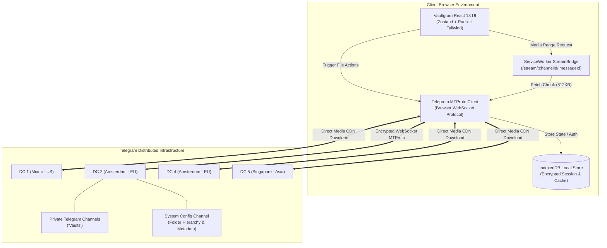

<p align="center">
  
</p>

<h1 align="center">Vaultgram</h1>

<p align="center">
  <strong>Browser-native, 100% serverless personal cloud drive and on-demand streaming engine powered directly by Telegram's MTProto API over WebSockets.</strong>
</p>

<p align="center">
  <a href="LICENSE"></a>
  
  
  
  
</p>

---

## Overview

Most cloud storage solutions force a compromise between monthly subscription rents, storage caps, and data privacy. Telegram offers virtually limitless cloud storage for personal media, but using it as a filesystem traditionally required third-party bots, intermediary server proxies, or heavy desktop wrappers—introducing latency, security vulnerabilities, and bot rate-limits.

**Vaultgram** fundamentally re-engineers this model:
- **No intermediary backend**: Your browser establishes direct encrypted MTProto WebSocket connections straight to Telegram Data Centers (DC 1 through DC 5).
- **No bot limitations**: Authenticates directly using your Telegram account credentials (API ID/Hash, QR login, or Session String).
- **On-the-fly streaming**: Watch 4K videos and listen to FLAC/MP3 audio instantly without downloading complete files first, enabled by a browser-native ServiceWorker range request emulation engine.

---

## Architectural Highlights



### Core Innovations

1. **Zero-Wait Range Streaming Engine (`StreamBridge`)**:
   Standard Telegram clients require downloading an entire media file to disk before playback begins. Vaultgram includes a dedicated ServiceWorker virtual HTTP bridge that translates standard browser HTML5 `<video>` / `<audio>` range requests (`bytes=0-524287`) directly into MTProto `upload.getFile` chunk fetches. Non-FastStart MP4 containers are parsed and remuxed in-browser using MP4Box and MSE (`MediaSource Extensions`).

2. **Universal Media Inspection Suite**:
   - **Video & Audio**: Seamless seeking, hardware-accelerated rendering, background audio dock with queue management.
   - **PDF Reader**: Built-in `pdfjs-dist` worker previewer with page rendering, zooming, and text search.
   - **Archive Explorer**: Inspect `.zip` file structures and extract individual documents in-memory via `jszip` without extracting the whole file.
   - **Code & Text Viewer**: Syntax-highlighted text preview for markdown, JSON, code, and log files.

3. **Cloud State Synchronization (`SyncStore`)**:
   Vaultgram stores virtual folder structures, custom labels, favorites, and pinned file states inside a designated hidden system channel (`Vaultgram Vault (Do Not Delete)`). Your drive layout persists seamlessly across multiple devices and browsers without any external database.

4. **Multi-Account & Multi-Vault Management**:
   Organize distinct channels as individual storage vaults (e.g., *Work Backups*, *Course Library*, *Raw Media*). Switch seamlessly between multiple logged-in accounts directly from the UI.

---

## Feature Matrix

| Feature | Vaultgram | Traditional Cloud (Drive/Dropbox) | Telegram Desktop / Web |
| :--- | :---: | :---: | :---: |
| **Storage Capacity** | Unlimited (Account Bound) | Tiered / Paid Monthly | Unlimited |
| **Middleman Servers** | None (100% Client-Side) | Proprietary Server Farm | Telegram Servers Only |
| **Direct Video Range Streaming** | Yes (Instant Playback) | Yes | No (Full Download Required) |
| **In-Browser Archive Inspection** | Yes (Zero Extraction) | No | No |
| **Virtual Folder Structuring** | Yes (Cloud Synced) | Yes | No (Linear Chat Only) |
| **Open Source License** | GNU AGPLv3 | Proprietary | GPL / Open Source |

---

## Keyboard Shortcuts

Vaultgram includes a keyboard-first command interface:

| Shortcut | Action |
| :--- | :--- |
| <kbd>Cmd</kbd> / <kbd>Ctrl</kbd> + <kbd>K</kbd> | Open Global Command Palette |
| <kbd>/</kbd> | Instant Focus Search Bar |
| <kbd>Shift</kbd> + <kbd>U</kbd> | Trigger Upload Picker |
| <kbd>Esc</kbd> | Dismiss Active Modal / Deselect Files |
| <kbd>Space</kbd> | Quick Look / Preview Selected File |
| <kbd>Delete</kbd> / <kbd>Backspace</kbd> | Batch Delete Selected Items |

---

## Getting Started

### Prerequisites
- Node.js `18.0.0` or higher
- npm or pnpm
- A Telegram account and personal API keys from [my.telegram.org](https://my.telegram.org)

### Installation & Development

1. **Clone the repository**:
   ```bash
   git clone https://github.com/xrnix/Vaultgram.git
   cd Vaultgram
   ```

2. **Install dependencies**:
   ```bash
   npm install
   ```

3. **Launch the development server**:
   ```bash
   npm run dev
   ```

4. **Connect your Telegram Account**:
   - Open your browser to `http://localhost:5173`.
   - Enter your `API ID` and `API Hash` from [my.telegram.org](https://my.telegram.org).
   - Authenticate via QR Code scan, SMS Phone Code, or paste an existing GramJS/Teleproto session string.

---

## Production Deployment

Because Vaultgram is 100% static and client-side, it requires zero backend servers and can be hosted on any static edge CDN (Cloudflare Pages, Vercel, Netlify, GitHub Pages, or self-hosted Nginx/Caddy).

### Single-Command Build

```bash
npm run build
```

This compiles TypeScript and produces the optimized static production bundle in `dist/`.

### Cloudflare Pages Configuration

- **Framework Preset**: `Vite`
- **Build Command**: `npm run build`
- **Build Output Directory**: `dist`
- **Node.js Version**: `18.x` or higher

> [!NOTE]
> The repository includes `public/_headers` and `public/_redirects` out of the box to ensure ServiceWorker scopes and SPA routing behave properly across edge CDNs.

---

## Security & Privacy Philosophy

1. **Zero Tracking & Zero Analytics**: There are no tracking pixels, telemetry probes, or third-party monitoring services embedded in this codebase.
2. **Local Credential Boundary**: API keys, phone numbers, and session authorization hashes are persisted strictly inside your browser's private `IndexedDB` storage.
3. **Pure MTProto Cryptography**: All payloads and file streams are encrypted and decrypted directly using Telegram's open MTProto 2.0 cryptographic specification.
4. **Headless Backup Portability**: Export your authenticated MTProto session string at any time from Settings for off-site backup or CLI automations.

---

## License

This project is licensed under the **GNU Affero General Public License v3.0 (AGPLv3)**. See the [LICENSE](LICENSE) file for the full license text.
